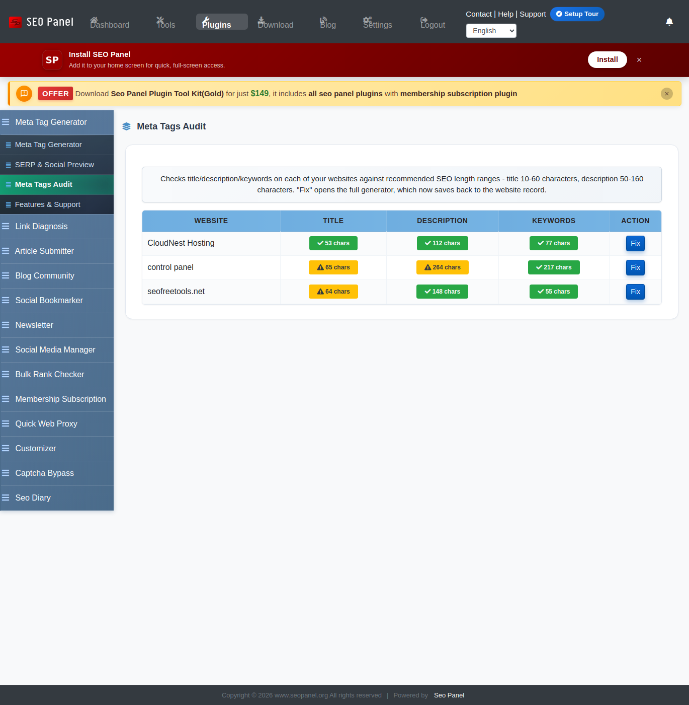

.. title:: Meta Tag Generator Plugin for SEO Panel | Create Meta Tags, Preview & Audit

.. meta::
   :description: Meta Tag Generator plugin for SEO Panel - create title, description, keywords and social-sharing (Open Graph/Twitter) tags per website, preview how a page looks in Google and on social media, and audit every website's tags at a glance.
   :keywords: meta tag generator plugin, seo panel meta tags, serp preview, social share preview, meta tags audit

Meta Tag Generator
~~~~~~~~~~~~~~~~~~~

.. raw:: html

   

     

       

         <i class="fa fa-tags" style="color: #fff; font-size: 22px;"></i>
       

       

         

           Meta Tag Generator Plugin
           v1.3.0
         

         
Bundled with every Seo Panel install - <strong style="color:#fff;">no separate download needed.</strong>

       

     

   

Meta Tag Generator creates and saves the full set of meta tags for each of your websites - title, description, keywords, Open Graph/Twitter sharing tags and search-engine directives - then lets you preview how the page will actually look in a Google result and on social media, and audit every website's tags at a glance. Unlike the optional download plugins elsewhere in this guide, it ships with Seo Panel itself, so there's nothing to install.

The plugin menu provides the following sections:

- **Meta Tag Generator** – Create or edit the full meta tag set for one website
- **SERP & Social Preview** – See how a title/description will look in Google and on social media before you publish
- **Meta Tags Audit** – A table of every website, flagging missing or out-of-range titles/descriptions/keywords
- **Features & Support** – About this plugin, with a link to report issues or request features

~~~~~~~~~~~~~~~~~~~
Meta Tag Generator
~~~~~~~~~~~~~~~~~~~

1) Go to **Seo Tools => Meta Tag Generator**, select a **Website** and click **Show Records**

   .. image:: ../_static/sp_meta_tag_generator.png

   - **Website Title** / **Website Description** – the core ``<title>`` and meta description tags, with a live character counter (100/255 - over-limit turns the counter red, but doesn't block saving)
   - **Canonical URL** – defaults to the website's own URL; clear it if this page shouldn't self-canonicalize
   - **Include Mobile Viewport Tag** – ticked by default; adds the standard responsive-design viewport tag
   - **Website Keywords** – comma-separated, with a counter capped at 12 unique terms
   - **Author** / **Email** / **Copyright** / **Expires** – optional attribution and expiry meta tags
   - **Language** / **Charset** – select boxes for the page's declared language and character set
   - **Search Engine Directives** – **Rating** (General/Mature/Restricted), **Distribution** (Global/Local), **Robots** (e.g. ``NOINDEX,NOFOLLOW`` keeps a page out of search results entirely and stops bots following its links - leave blank for the default, ``INDEX,FOLLOW``) and **Revisit-after** (1 to 365 days)
   - **Social Sharing (Open Graph / Twitter Card)** – **Share Title**/**Share Description** (blank reuses the Website Title/Description above), **Share Image URL** (1200x630px or larger recommended) and **Canonical Share URL**, plus a **Twitter Card Type** (Summary or Summary with Large Image)
   - Click **Proceed** to save

If `Local AI is set up <../user_guide/settings.html#local-ai-settings>`_ (**Admin Panel => System Settings => Local AI Settings**), a **Suggest Title & Description with AI** button appears above the form - it drafts both fields from your on-premise Ollama instance (nothing sent to a third party). Review and edit the draft before saving; it only fills the Website Title/Description fields and doesn't touch anything else on the form.

~~~~~~~~~~~~~~~~~~~~~~
SERP & Social Preview
~~~~~~~~~~~~~~~~~~~~~~

1) Go to **Seo Tools => Meta Tag Generator => SERP & Social Preview**, select a **Website** and click **Show Records**

   .. image:: ../_static/sp_meta_tag_preview.png

   - Edit the **Title** and **Description** fields directly on this page (separate from, and not saved back to, the Meta Tag Generator form) and optionally add a **Share Image URL**
   - The **Google Search Preview** updates live as you type, truncated the same way Google typically does - 60 characters for the title, 160 for the description, each with its own counter that turns red past the limit
   - The **Social Share Preview** shows how the page's card looks when shared on social media/chat apps, including the share image if one is set

This is a what-if preview only - it doesn't save anything. Use it to try wording before copying it into the Meta Tag Generator form above.

~~~~~~~~~~~~~~~~~
Meta Tags Audit
~~~~~~~~~~~~~~~~~

Go to **Seo Tools => Meta Tag Generator => Meta Tags Audit** for a one-page health check across every website you manage.

Each website gets a badge per field:

- **Missing** (red) – the field is empty
- A **character count** (amber) – outside the recommended range: title under 10 or over 60 characters, description under 50 or over 160
- A **character count** (green) – within range (Keywords only ever shows Missing or a plain count - it has no recommended range)

Click **Fix** on any row to jump straight into the Meta Tag Generator form for that website.
