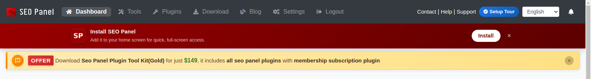

.. title:: SEO Panel Dashboard | Daily Report Summary & Competitor Analysis

.. meta::
   :description: Guide for SEO Dashboard of seo panel with daily report summary, competitor analysis and overall summary. 

Dashboard
~~~~~~~~~~~~~

~~~~~~~~~~~~~~~~~
Dashboard Reports
~~~~~~~~~~~~~~~~~

Here you can see overall reports of websites added in seo panel.

1) Go to **Dashboard**

2) Enter search filter value according to your requirements.

   .. image:: ../_static/sp_dashboard.png
   
   **Filters**

   - **Name** - Enter required keyword filter the reports

   - **Period** - Enter date interval to filter the reports

   - **Website** - Choose required website to filter the results

   - **Report Type** - You can select different reports types
   
      - **Keyword Position Summary** - Select to get keyword reports only
      
      - **Website Statistics** - Select to get website reports only

3) **Click on 'graph'** icon to see reports in graph as below screen shot

   .. image:: ../_static/sp_dashboard_graph.png 

4) **Click on 'rank'** link to see reports in more detailed format as below screen shot

   .. image:: ../_static/sp_dashboard_difference.png 

5) You can also choose following to download and print reports in different formats

   - **PDF** - Click on `PDF icon` to download reports in PDF format
   
   - **Export** - Click on `Export Icon` to download reports in `.csv` format
   
   - **Print** - Click on `Print Icon` to print te reports

~~~~~~~~~~~~~~~~~~~~~~~~~~~~~~~~~~~~
Setup Tour & Installing as an App
~~~~~~~~~~~~~~~~~~~~~~~~~~~~~~~~~~~~

New in Seo Panel 7.0.0, both shown right in the top bar:

- **Setup Tour** - A guided, step-by-step walkthrough of a fresh install: add your first website, run your first keyword check, and connect the AI Visibility suite. Click it any time from the top bar to replay it, *Eg:* after upgrading and wanting a refresher on what's new

- **Install SEO Panel** - Seo Panel is now a installable PWA (Progressive Web App). Click **Install** on this banner (or your browser's own install prompt) to add it to your desktop or phone's home screen for full-screen, app-like access without the browser chrome. Dismiss the banner with the **x** if you'd rather keep using it in a regular browser tab